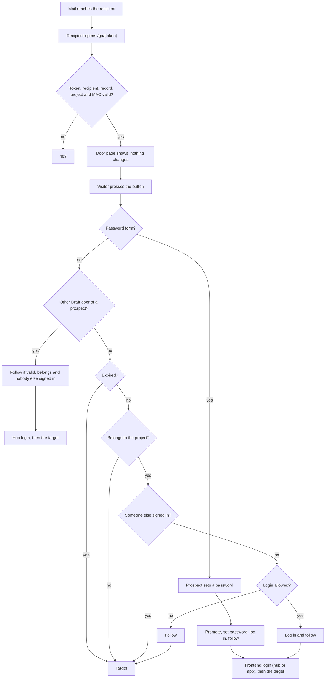

# Mailer Door

Signed links in mails, called doors. The `mailer` module puts them into its
mails; this module builds, verifies and opens them.

## What a door is

A door is `/go/{token}` (route `mailer_door.go`), placed in a mail in front of
a target on the hub (organizations) or the app (creatives).

- Opening the door does nothing: mail scanners open links. The page shows a
  heading, the project title and a button.
- Pressing the button may log the recipient in, logs the follow, then
  redirects to the target.

## User flow



- **403**: a malformed token, an unknown user, a missing correspondence record
  or one that is no mail, a mail without project, a wrong MAC, an anonymous or
  blocked recipient. The checks run again on the press.
- **Door page**: opening only shows it, because mail scanners open links.
- **Password form**: a prospect on a `Draft` door to a project still in
  draft, when the door would otherwise log in: not expired, the project
  belongs to it, nobody is signed in, the door is newer than its last login.
  A cross-site post gets an error and changes nothing.
- **Other Draft door of a prospect**: every other `Draft` door of a prospect
  is spent and leads to the hub login, which opens the target after signing
  in. This also holds when it is expired, foreign or someone else is signed
  in. It writes the follow log only when the door
  is not expired, belongs, and nobody else is signed in.
- **Expired**, **not on the project**, **someone else signed in**: no login
  and no follow log, the target opens.
- **Login allowed**: the recipient is no staff and no prospect, nobody is
  signed in, the door is newer than the last login, and the press comes from
  this site. Every target logs in. The login goes through the recipient's
  frontend: the hub for organizations, the app for creatives.
- **Follow** without login: staff, for example a manager who takes part in a
  project, older doors, a recipient who is already signed in, and a cross-site
  press of a login door.
- A follow log is written once per mail and target.

## The token

The payload is packed into bytes, followed by a MAC:

| Offset | Bytes | Content                                           |
|--------|-------|---------------------------------------------------|
| 0      | 1     | version (`DoorLinks::VERSION`, 1)                 |
| 1      | 4     | uid of the recipient                              |
| 5      | 16    | UUID of the correspondence record of the mail     |
| 21     | 1     | target code (`DoorTarget::code()`)                |
| 22     | 4     | timestamp, when the door was made                 |
| 26     | 16    | optional subject: the creative UUID of `Applicant` |

- The MAC is HMAC-SHA256 truncated to 128 bits, keyed with the hash salt plus
  the recipient's password hash (`DoorLinks::mac()`).
- The bytes are base64url without padding: 56 characters, or 78 with a subject.
  `parse()` accepts only the canonical encoding.
- A door stops working when the recipient's password changes, which changes
  the key, and after 30 days (`DoorLinks::LIFETIME`). An expired door no longer
  logs in or writes a follow log, but still leads to its target.
- The URL is never stored: the mailer redacts it from the recorded mail body
  as `[Link entfernt]`.

## Targets

| Case         | Code | Leads to (`targetUrl()`)                            | Mails                                                     | Logs in |
|--------------|------|-----------------------------------------------------|-----------------------------------------------------------|---------|
| `Draft`      | 1    | hub `/draft/{project}`, or `/projects/{project}` once submitted | `mailer.project_action.notify_organization`, `mailer.project_action.invite_organization`, `mailer.manager.reminder_draft` | yes |
| `Applicants` | 2    | hub `/projects/{project}`                           | `mailer.manager.reminder_open`                                   | yes     |
| `Edit`       | 3    | hub `/projects/{project}`                           | `mailer.manager.reminder_open_noone`                             | yes     |
| `Complete`   | 4    | hub `/projects/{project}`                           | `mailer.manager.reminder_ongoing`                                | yes     |
| `Applicant`  | 5    | hub `/users/{creative}`                             | `mailer.project_action.apply_organization`                       | yes     |
| `Feedback`   | 6    | organizations: hub `/projects/{project}/feedback`; creatives: app `/projects/{project}/feedback` | `mailer.project_transition.complete_organization`, `mailer.project_transition.complete_creative` | yes |

The codes are fixed per case, so reordering the cases keeps issued doors.

## What pressing does

`DoorLinks::verdict()` decides; `DoorForm` acts on it, on build and again on
submit.

- **Login** when the door is not expired, the project belongs to the recipient
  (owner, or a participating creative for `Feedback`), nobody is signed in,
  the recipient is no staff (`access site`), and the door is not older than
  the recipient's last login. So a login spends all older doors of that
  account. Then it redirects to the login of the recipient's frontend
  (`loginUrl()`), which opens the target; without a login it redirects to the
  target.
- **Prospects** never log in by the plain button. Where a door would log a
  prospect in, and it is a `Draft` door to a project still in draft, it shows
  a password form instead. The password
  is checked against the organization password policy. Pressing promotes the
  prospect to an organization, sets the password and logs it in.
- **Spent draft doors**: any other `Draft` door of a prospect leads to the hub
  login (`loginUrl()`), where the prospect signs in and lands on the target.
- **Frontend login**: `loginUrl()` is the base of the recipient's frontend
  plus `oauth_grant.settings:auth_success_redirect`: the hub
  (`youvo.settings:hub_url`) for organizations, the app
  (`youvo.settings:app_url`) for everybody else. For a target on that frontend
  it adds `redirect=<path>`, the target's path and query without scheme and
  host; any other target is left out. The frontend keeps it in its session and
  opens it after the OAuth callback, resolved against its own host, so it
  cannot redirect elsewhere. After a login core
  appends `check_logged_in=1`.
- **Follow log**: when the door is not expired, the project belongs to the
  recipient, and nobody else is signed in. Staff get it too, for example a
  manager who takes part in a project; they are only never logged in. It is
  written once per mail and target (key/value collection `mailer_door.follow`)
  through a `ProjectFollowEvent`.
- **Login CSRF**: the forms are anonymous and carry no form token. A login
  needs a same-site request: `Sec-Fetch-Site`, if sent, is `same-origin` or
  `none`, and `Origin`, if sent, has the host and port of the site. A
  cross-site password form gets an error and changes nothing.
- **403** for a malformed token, an unknown user, a correspondence record that
  is missing or no mail, a mail without project, a wrong MAC, and an anonymous
  or blocked recipient.

## Making links without a mail

`/admin/door-links` (route `mailer_door.links`, permission
`create mail door links`, granted to no role) makes working doors for any
project, recipient and target.

- Choosing a project and pressing „Vorschläge zeigen“ lists the doors that fit
  its state (`DoorLinkGenerator::suggestions()`).
- Each link comes with an outcome line from the same verdict as the door
  (`DoorLinkGenerator::outcome()`).
- Each link gets a correspondence record like a sent mail, with `result`
  `link` and subtype `mailer_door.{target}`, so the door logs in and writes
  its follow log as usual. The link is shown once and never stored.

## Where things live

| File                                       | Role                                            |
|--------------------------------------------|-------------------------------------------------|
| `src/DoorLinks.php`                        | builds, parses, verifies; verdict and target URLs |
| `src/DoorTarget.php`                       | targets with code and heading                   |
| `src/DoorToken.php`, `src/DoorVerdict.php` | the parsed facts and the verdict                |
| `src/HubUrls.php`                          | hub and app base URLs and project links, also used by `mailer` |
| `src/DoorLinkGenerator.php`                | links without a mail: record, suggestions, outcome |
| `src/Form/DoorForm.php`                    | the door page and its button                    |
| `src/Form/DoorLinkForm.php`                | `/admin/door-links`                             |
| `src/Controller/DoorLinkAutocompleteController.php`, `src/Element/DoorLinkTags.php` | the Tagify fields of that form |
| `src/Hook/MailerDoorHooks.php`             | theme hook, page suggestion `page__mailer_door`, body class `mail-door-body` |
| `templates/mail-door.html.twig`, `js/`     | the door card, the password checklist, the tag fields |

The yv theme styles the page: `templates/page--mailer-door.html.twig` and
`sass/components/_mail-door.scss`.

## Tests

| File                                         | Covers                                          |
|----------------------------------------------|-------------------------------------------------|
| `tests/src/Unit/DoorLinksTest.php`           | token format, tampering, MAC over the uid, expiry, login rule, target and login URLs |
| `tests/src/Unit/HubUrlsTest.php`             | hub and app links                               |
| `tests/src/ExistingSite/MailDoorTest.php`    | the door page: login, follow, rejections, same-site checks, feedback |
| `tests/src/ExistingSite/MailDoorInviteTest.php` | prospect invitation and password form        |
| `tests/src/ExistingSite/DoorLinkFormTest.php` | `/admin/door-links` against the real door      |
| `tests/src/ExistingSite/DoorLinkAutocompleteTest.php` | the suggestions of its fields          |

`tests/src/Traits/DoorTokenTrait.php` reads and tampers with tokens; the
mailer tests use it too.

```sh
# Unit, on the host
SIMPLETEST_DB="sqlite://localhost/:memory:" vendor/bin/phpunit web/modules/custom/mailer/door/tests/src/Unit
# ExistingSite, in DDEV
ddev exec vendor/bin/phpunit -c phpunit.ddev.xml web/modules/custom/mailer/door/tests/src/ExistingSite
```
